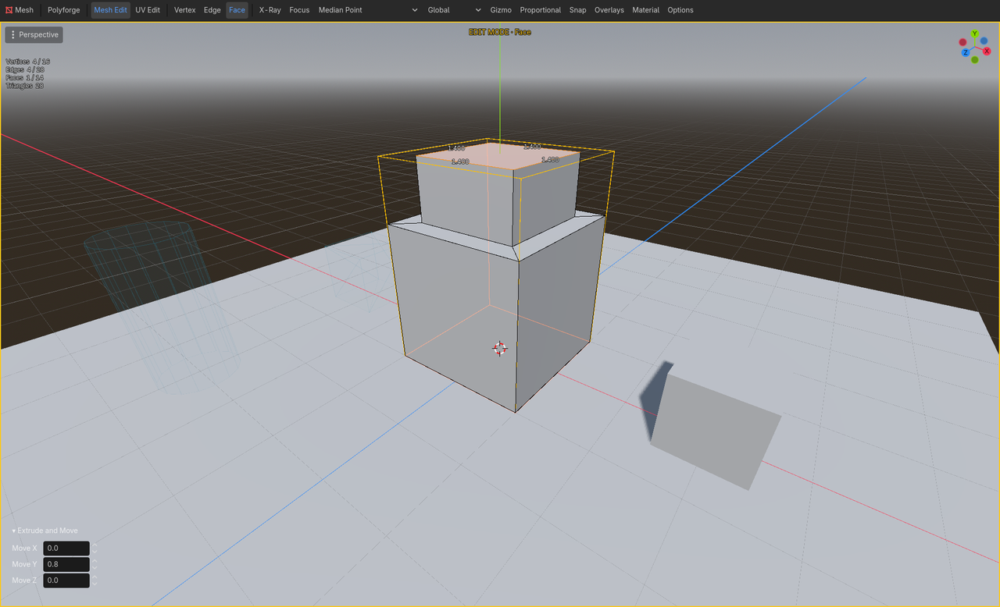
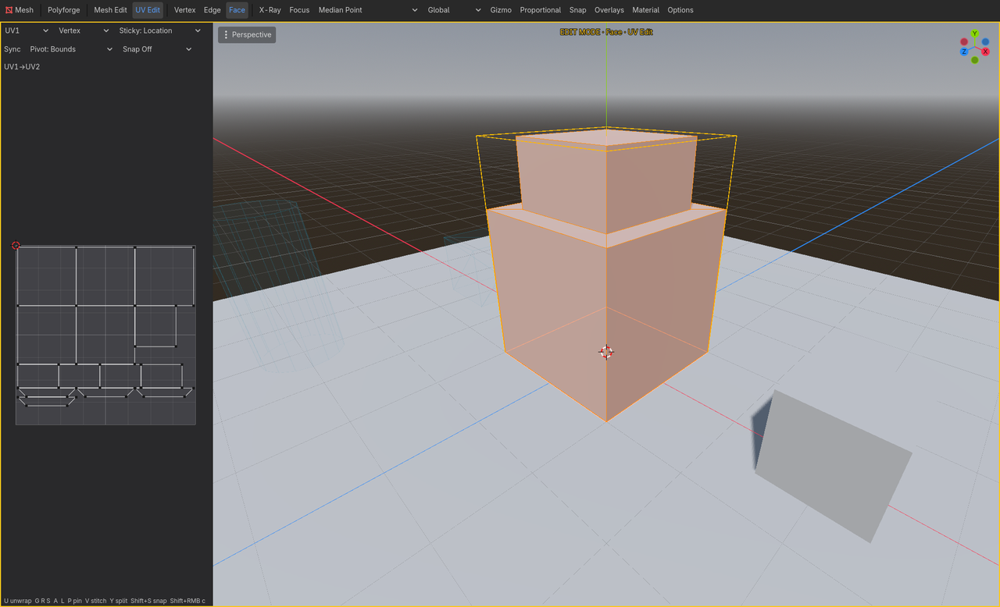
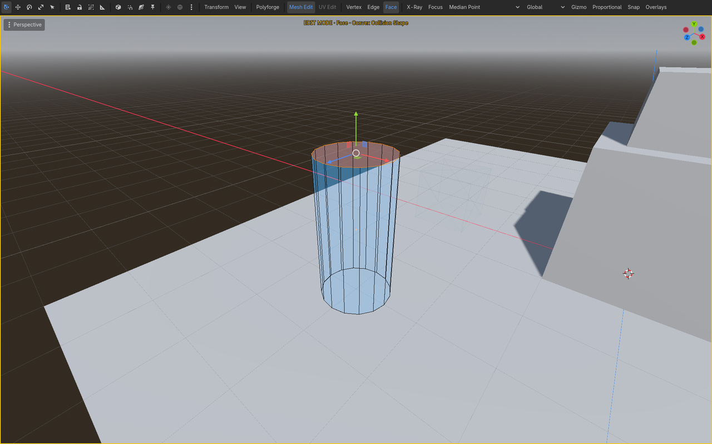

<p align="center">
  <picture>
    <source media="(prefers-color-scheme: dark)" srcset="docs/logo_white.svg">
    
  </picture>
</p>

# Polyforge

Blender-style mesh and UV editing inside the **Godot 4.7** editor, for people who know Blender:
press **Tab** to enter Edit Mode, use Blender's shortcuts, and get plain Godot meshes as the result.

*[Wersja polska](README.pl.md)*

If Polyforge is useful to you, you can support it here: [ko-fi.com/seba313](https://ko-fi.com/seba313)

**Version 0.1.0 (beta):** modelling, UV editing, collision shapes, 3D cursor, proportional editing,
snapping and overlays. Feedback and bug reports are very welcome in
[Issues](../../issues).





## Installation

- **In your project:** copy `addons/polyforge/` into your project's `addons/` folder and enable
  the plugin in *Project Settings → Plugins → Polyforge*.
- **Test project from this repository:** in Godot 4.7 choose **Import**, select `project.godot`
  and open `test_scene.tscn`. The plugin is already enabled there.

Polyforge declares no global `class_name`, so it works next to other addons (including MeshBuilder).

## How it works

- **Object Mode is plain Godot.** Polyforge only reacts to `Tab` and `Numpad /`. Optional
  Blender shortcuts for Object Mode can be enabled in the settings.
- **Tab** on a selected `MeshInstance3D` enters **Edit Mode**: a thin yellow frame around the 3D
  view, an `EDIT MODE · Vertex` label and the Edit Mode bar in the 3D toolbar. While the mouse is
  over the 3D view, the Blender keymap handles the keyboard.
- **New objects:** *Polyforge → Add Mesh* in the 3D toolbar (Cube, Plane, Circle, UV Sphere,
  Ico Sphere, Cylinder, Cone, Torus, Grid). Sizes match Blender; the object is placed at the
  3D cursor and opens in Edit Mode.
- **Tab on Godot primitives** (`BoxMesh`, `PlaneMesh`/`QuadMesh`, `CylinderMesh`, `SphereMesh`,
  `TorusMesh`, `PrismMesh`) converts them into Polyforge meshes (one undo step). Other meshes
  (for example from `.glb` files) cannot be edited yet.
- **The result is always a plain `ArrayMesh` in a plain `MeshInstance3D`.** Edit data is stored
  as metadata (plain arrays, no scripts), so your game and saved scenes do not need the addon.

## Multi-object editing, Join, Boolean

- **Several objects at once:** select several meshes and press `Tab`. The last selected object is
  active. New faces belong to the object they grew from, and undo keeps working after you leave
  Edit Mode.
- **Join** (*Polyforge → Join Selected Meshes*, optionally `Ctrl+J` in Object Mode) merges the
  selected meshes into the last selected one.
- **Boolean:**
  - in Edit Mode: `Ctrl+F` → *Intersect (Boolean)* → Union / Difference / Intersect (the selected
    faces cut the rest of the mesh),
  - between objects: *Polyforge → Boolean* (the last selected object changes, the others cut it
    and stay in the scene).

  It uses Godot's CSG (Manifold), so both shapes must be closed.

## Adjust Last Operation

After an operation, a panel with its parameters appears in the lower-left corner of the 3D view
(`F9`), as in Blender: Add (size, segments…), Extrude, Inset, Bevel, Loop Cut, Shrink/Fatten,
Duplicate, Merge by Distance, Smooth, and the UV operations. Changing a value repeats the operation
and still leaves a single undo step.

## Transform orientation and gizmo

- **Orientation** (Edit Mode bar or `,`): Global, Local, Normal, View. The first `X`/`Y`/`Z` press
  in `G`/`R`/`S` uses the chosen orientation, the second one Global (or Local when Global is chosen).
- **Gizmo** (optional, off by default): the *Gizmo* button (Move / Rotate / Scale separately) or
  `` Ctrl+` ``. It sits at the pivot, follows the orientation and keeps a constant on-screen size.

## Collision shapes (Convex / Concave)

`Tab` on a `CollisionShape3D` with a `ConvexPolygonShape3D` or `ConcavePolygonShape3D` enters
Edit Mode with the same shortcuts.

- **Concave (trimesh):** triangles are welded into a mesh and coplanar pairs are joined into quads.
  Deleting faces leaves holes that bodies can fall through; Polyforge warns you about them.
- **Convex:** you edit the hull points; flat faces are n-gons. The shape always stays convex.
  Points that end up inside the hull are removed (with a message), and operations that would make
  the shape flat are cancelled.
- Box, Sphere, Capsule and Cylinder shapes keep Godot's own handles.

## Edit Mode shortcuts (Blender)

| Key | Action |
|---|---|
| `Tab` | Object Mode ↔ Edit Mode |
| `1` / `2` / `3` | vertex / edge / face select mode |
| click, `Shift`+click | select / extend |
| `Alt`+click, `Ctrl+Alt`+click | edge loop / edge ring |
| LMB drag on empty space | box select (`Shift` extend, `Ctrl` subtract) |
| `B`, `C` | box select, circle select |
| `A`, `Alt+A`, `Ctrl+I` | select all / none / invert |
| `L`, `Shift+L`, `Ctrl+L` | select / deselect linked under the cursor, select linked |
| `Ctrl+Numpad +` / `-` | select more / less |
| `Shift+G` | Select Similar |
| `H`, `Shift+H`, `Alt+H` | hide selected / hide unselected / reveal |
| `Alt+Z` | X-Ray |
| `G` / `R` / `S` | move / rotate / scale (modal) |
| `G` `G` | vertex slide |
| `.` / `,` | pivot menu / orientation menu |
| `Shift+A` | add a primitive to the edited mesh |
| `E`, `Alt+E` | extrude and move, extrude menu |
| `I` | inset (`I` again: individual faces) |
| `Alt+S` | shrink/fatten |
| `Shift+D` | duplicate and move |
| `F` | make edge / face; joins selected faces into one (e.g. two triangles into a quad) |
| `X`, `Delete` | delete menu |
| `Ctrl+X` | dissolve |
| `M` | merge menu (unlike Blender, At First / At Last also work after box / circle selecting vertices one by one) |
| `Shift+N`, `Ctrl+Shift+N`, `Alt+N` | recalculate normals outside / inside, normals menu |
| `Ctrl+T`, `Alt+J` | triangulate, tris to quads |
| `Ctrl+V`, `Ctrl+E`, `Ctrl+F` | vertex / edge / face menus |
| `Ctrl+R` | loop cut and slide (wheel: number of cuts) |
| `Ctrl+B`, `Ctrl+Shift+B` | bevel edges (wheel: segments), bevel vertices |
| `J` | connect vertex path |
| `P` | separate (selection / loose parts / material) |
| `U` | UV menu |
| `Shift`+RMB | place the 3D cursor |
| `Shift+S` | snap menu (selection ↔ cursor, selection / cursor to grid: Ctrl snap increment from the settings) |
| `O`, `Shift+O` | proportional editing, falloff menu |
| `Shift+Tab`, `Ctrl+Shift+Tab` | snapping on/off, snap target (Increment / Vertex / Edge / Face) |
| `Ctrl+M` | mirror (X/Y/Z, Global or Local) |
| `Alt+F` | Focus mode: dims everything except the edited object |
| `F3` | operator search |
| `F9` | Adjust Last Operation |
| RMB | context menu (hold: Godot's fly camera, WASD) |
| `Numpad .` | View Selected: centre and zoom the view on the selected elements |
| `Numpad /` | Local View (also in Object Mode) |
| `Ctrl+PageUp` / `Ctrl+PageDown` | Mesh Edit / UV Edit tab |
| `Ctrl+Z`, `Ctrl+Shift+Z` | undo / redo (Godot's history; selection changes are steps too) |

The full list is also in *Polyforge → Shortcuts*.

**Modal G / R / S:** `X`/`Y`/`Z` constrain to an axis, `Shift+X/Y/Z` to a plane; type a value
(`G Z 2 Enter`, `R X 90 Enter`, `S 0.5 Enter`); `Ctrl` snaps, `Shift` gives precision. LMB /
`Enter` / `Space` confirms, RMB / `Esc` cancels.

Other keys are blocked in Edit Mode so that Godot does not react unexpectedly. Numpad views,
`Ctrl+S`, `Ctrl+Z`, the F keys (running the game) and mouse navigation still go to Godot.

## Edit Mode bar

- **Proportional:** on/off, *Connected Only*, falloff and *Mesh Symmetry* X/Y/Z. During
  `G`/`R`/`S` the mouse wheel or `PageUp`/`PageDown` changes the radius.
- **Snap:** with Vertex / Edge / Face the selected vertex closest to the target lands on the element
  under the mouse. Increment snaps to the grid step.
- **Overlays:** Statistics, Edge Length (also for the edges being stretched during a transform),
  Face Orientation (blue = front, red = back), Face Normals.
- **Material:** toggles a strip right of the 3D view with one thumbnail per material slot (pick a material
  or drag one from the FileSystem dock). Icons under each thumbnail: Assign to the selected faces, Select,
  Deselect, Remove slot; *Add* creates a new slot. Each slot becomes a separate `ArrayMesh` surface.
- **3D cursor:** also usable as the pivot; new primitives are added there. It is not saved in the scene.

## Vertex Paint (Paint tab)

The **Paint** tab (next to Mesh Edit / UV Edit) paints vertex colours, like Blender's Vertex Paint mode.
Colours are stored per face corner, so brush strokes blend smoothly while fills can have sharp borders.

- LMB paints the primary colour, `Ctrl`+LMB the secondary one, `X` swaps them.
- `F` / `Shift+F`: brush radius / strength (move the mouse, LMB confirms, RMB cancels); `S` samples the
  colour under the mouse; `Shift+K` fills the selected faces (all faces when nothing is selected).
- Bar: colours, blend mode (Mix / Add / Subtract / Multiply), radius, strength, *Mask* (paint only the
  selected faces), *Front Faces*, *Preview* (shows the vertex colours instead of the material; editor only).
  Mesh Symmetry X (Proportional menu) mirrors the strokes.
- Each stroke is one undo step. The result is the `COLOR` array of the `ArrayMesh`. To see it in the game,
  the material must use vertex colours (e.g. StandardMaterial3D → *Vertex Color → Use as Albedo*).

## UV

- **By default UVs work as in Blender:** they live on face corners, so moving vertices can stretch
  the texture.
- **Options → Correct Face Attributes** (off by default, as in Blender): moving vertices keeps
  the texture from stretching.
- **Options → World-Scale UV** (optional, MeshBuilder-style, per object; the project default is in
  the settings): UVs in world units at a chosen **Texel Density** (128 / 256 / 512 / custom px/m,
  default 256), independent of the texture resolution. Editing never stretches the texture and
  scaling adds tiles.
- **Seams:** `Ctrl+E` → Mark Seam / Clear Seam.
- **`U` menu** (3D view or UV view): Unwrap (LSCM along seams, pinned vertices stay), Smart UV
  Project, Cube / Cylinder / Sphere Projection, Project from View, Reset, Lightmap Pack, Pack
  Islands, Average Islands Scale, Texel Density.
- **UV Edit tab:** a UV editor next to the 3D view, with UV1/UV2 channels, Vertex / Face / Island
  select modes, Sticky, UV Sync Selection, pivot and snapping (to texture pixels or vertices),
  a 2D cursor (`Shift`+RMB, `Shift+S`), `G`/`R`/`S`, pin (`P` / `Alt+P`), pack (`Ctrl+P`),
  stitch (`V`) and split (`Y`).

## Translations

Polyforge follows the editor language (*Editor Settings → Interface → Editor → Editor Language*).
Polish is included; any other language shows English. To add a language, create
`addons/polyforge/i18n/<language code>.po` with the English texts as `msgid` (see `pl.po`).
Pull requests are welcome.

## Settings

*Polyforge → Settings…*: frame colour and width, Right Click Select, snap increment, Local View
framing, optional Object Mode shortcuts (remappable) and project defaults (World-Scale UV, texel
density).

User preferences are stored in `polyforge.cfg` in Godot's editor configuration folder; project
defaults go to `project.godot` (`polyforge/uv/...`). Polyforge never changes Godot's own settings
or shortcuts.

## Limitations

- Bevel uses a simple arc profile (no profile options or clamp overlap); corners where 5 or more
  bevelled edges meet can produce an n-gon.
- Boolean results are triangles joined into quads (no n-gons) with flat shading.
- In multi-object editing, hiding (`H`) only affects selection, not the view.
- Element snapping works only for moving (`G`); rotate and scale snap by increments.
- Snap targets are only in the edited mesh, not in other scene objects.
- UV Stitch meets halfway (no island snapping); UV Sync works per vertex (per face in face mode).
- Arbitrary meshes and `.glb` files cannot be imported for editing yet.
- Local View cannot restore the previous camera position (Godot does not expose the editor camera).
- While editing, the node shows a lock icon in the Scene dock: Polyforge locks it temporarily to
  hide Godot's move gizmo. The lock is never saved in the scene.

## Tests

```bash
./tests/run_tests.sh
```

Core tests run headless; the editor tests run in a temporary copy of the project and send real
viewport events. Every Godot run uses a temporary configuration folder, so the tests never change
your editor settings.

## License

MIT, see [`LICENSE`](LICENSE). Parts of the code (modal transforms, UV correction) are derived
from MeshBuilder (MIT).

## Support

[ko-fi.com/seba313](https://ko-fi.com/seba313)
