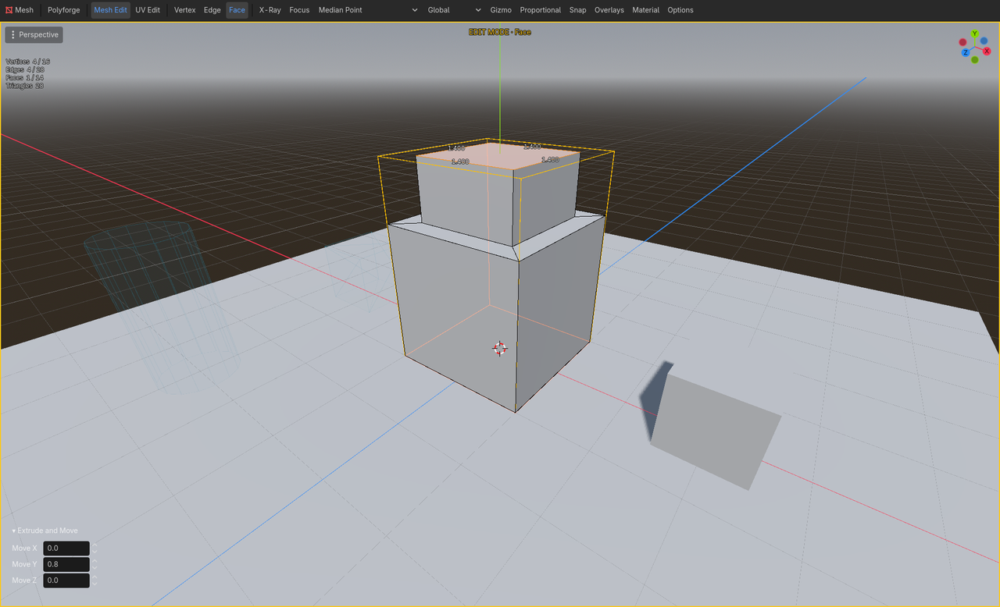
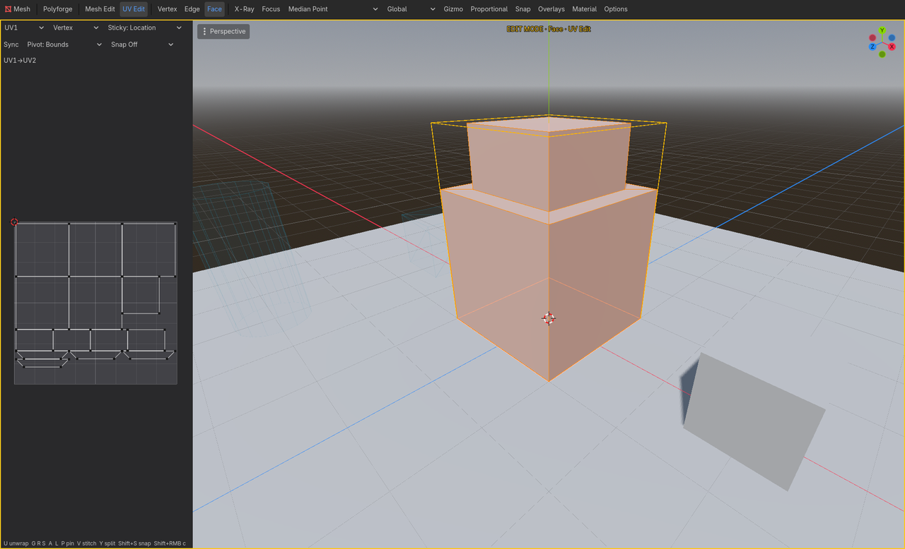
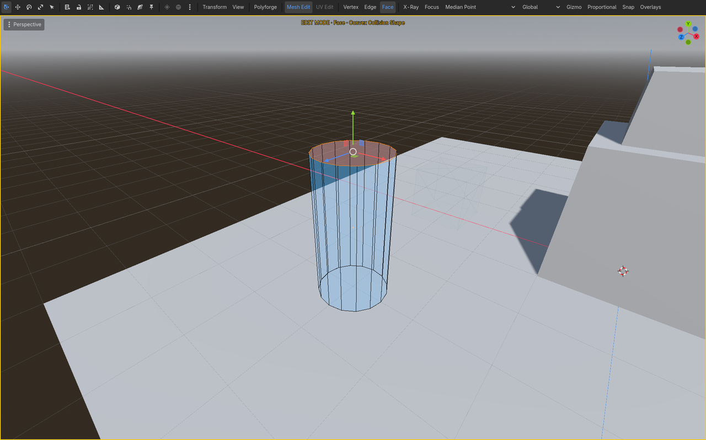

<p align="center">
  <picture>
    <source media="(prefers-color-scheme: dark)" srcset="docs/logo_white.svg">
    
  </picture>
</p>

# Polyforge

Edycja siatki w Godot 4.7 tak jak w Blenderze, dla osób, które znają Blendera:
**Tab** wchodzi w tryb edycji, skróty Blendera, wynikiem są zwykłe meshe Godota.

*[English version](README.md)*

Wersja 0.1.0 (beta): modelowanie, edycja UV, kształty kolizji, kursor 3D, proportional editing,
przyciąganie, nakładki. Wymaga **Godot 4.7**.

Jeśli Polyforge Ci się przydaje, możesz wesprzeć projekt: [ko-fi.com/seba313](https://ko-fi.com/seba313)





## Jak otworzyć

**We własnym projekcie:** skopiuj `addons/polyforge/` do folderu `addons/` projektu i włącz
plugin w *Project Settings → Plugins → Polyforge*.

**Projekt testowy z tego repozytorium:** Godot 4.7 → **Import** → `project.godot` → otwórz
`test_scene.tscn` (plugin jest już włączony).

Polyforge nie deklaruje żadnego globalnego `class_name`, więc działa obok
MeshBuildera i innych addonów (bez błędu „hides a global script class”).

## Jak to działa

- **Tryb obiektowy to zwykły Godot.** Polyforge reaguje tylko na `Tab` i `Numpad /`
  (opcjonalne skróty Blendera dla trybu obiektowego można włączyć w ustawieniach).
- **Tab** na zaznaczonym `MeshInstance3D` wchodzi w **tryb edycji**:
  cienka żółta ramka wokół widoku 3D, napis `EDIT MODE · Vertex` u góry, pasek trybu
  edycji w pasku narzędzi 3D (`Mesh Edit | UV Edit`, Vertex/Edge/Face, X-Ray, pivot,
  Options). Gdy kursor jest nad widokiem 3D, klawiaturę obsługuje keymap Blendera.
- Nowe obiekty: **Polyforge → Add Mesh** w pasku 3D (Cube, Plane, Circle, UV Sphere,
  Ico Sphere, Cylinder, Cone, Torus, Grid — rozmiary jak w Blenderze, w miejscu
  kursora 3D (domyślnie początek układu), od razu w trybie edycji).
- `Tab` na prymitywach Godota (`BoxMesh`, `PlaneMesh`/`QuadMesh`, `CylinderMesh`,
  `SphereMesh`, `TorusMesh`, `PrismMesh`) zamienia je na mesh Polyforge (jeden krok
  undo). Innych meshy (np. z `.glb`) na razie nie da się edytować.
- Wynik to zawsze **zwykły `ArrayMesh` w zwykłym `MeshInstance3D`**. Dane do edycji
  są zapisane jako metadane (same tablice, bez skryptów) — gra i zapisane sceny nie
  potrzebują addonu.

## Edycja kilku obiektów, Join, Boolean

- **Kilka obiektów naraz:** zaznacz kilka meshy i `Tab` — wszystkie w trybie edycji (ostatnio
  zaznaczony jest aktywny). Operacje działają na wszystkich; nowe ściany należą do obiektu, z którego
  wyrosły; undo działa także po wyjściu z trybu edycji.
- **Join** (`Polyforge → Join Selected Meshes`, opcjonalnie `Ctrl+J` w trybie obiektowym): zaznaczone
  meshe trafiają do ostatnio zaznaczonego.
- **Boolean:** w trybie edycji `Ctrl+F` → *Intersect (Boolean)* Union / Difference / Intersect (zaznaczone
  ściany tną resztę siatki); między obiektami `Polyforge → Boolean` (ostatnio zaznaczony jest zmieniany,
  pozostałe tną i zostają). Liczone przez CSG Godota (Manifold); bryły muszą być zamknięte.

## Adjust Last Operation

Po operacji w lewym dolnym rogu widoku 3D pojawia się panel z jej parametrami (jak w Blenderze):
Add (rozmiar, segmenty…), Extrude (przesunięcie), Inset (grubość, Individual), Bevel (szerokość,
segmenty), Loop Cut (liczba cięć, Factor), Shrink/Fatten, Duplicate, Merge by Distance, Smooth.
Zmiana wartości powtarza operację — zostaje jeden krok undo. Panel znika przy każdej innej zmianie.

## Orientacja transformacji i gizmo

- **Orientacja** (pasek trybu edycji albo `,`): **Global**, **Local** (osie obiektu), **Normal**
  (zaznaczenie: Z = średnia normalna zaznaczonych ścian / ścian wokół krawędzi lub vertexów,
  Y wzdłuż aktywnej krawędzi lub najdłuższej krawędzi aktywnej ściany), **View** (kamera).
  Pierwsze `X`/`Y`/`Z` w `G`/`R`/`S` używa wybranej orientacji, drugie — Global.
- **Gizmo (opcjonalne, domyślnie wyłączone)** — przycisk *Gizmo* w pasku (Move / Rotate / Scale,
  osobno) albo `Ctrl+`` (włącza Move / wyłącza wszystko). Stoi w punkcie pivota, ustawione
  według orientacji, zawsze tej samej wielkości na ekranie:
  - Move: strzałki osi, kwadraty płaszczyzn, kółko w środku (ruch w płaszczyźnie widoku),
  - Rotate: pierścienie osi + zewnętrzny pierścień (obrót wokół osi widoku),
  - Scale: osie zakończone kwadracikiem + pierścień (skala jednolita).
  Przeciągnij uchwyt — puszczenie przycisku zatwierdza, prawy przycisk / `Esc` anuluje; w trakcie
  działają wpisywanie wartości, `Ctrl` (przyciąganie) i `Shift` (precyzja). Jeden krok undo.

## Kształty kolizji (Convex / Concave)

`Tab` na `CollisionShape3D` z kształtem `ConvexPolygonShape3D` albo `ConcavePolygonShape3D`
wchodzi w tryb edycji z tymi samymi skrótami (zaznaczanie, `G`/`R`/`S`, ukrywanie, undo…).
Ściany kształtu są rysowane na półprzezroczysto (kształt nie ma własnej powierzchni).

- **Concave (trimesh):** trójkąty są sklejane w siatkę, a pary współpłaszczyznowych trójkątów
  łączone w quady. Po edycji kształt dostaje z powrotem trójkąty (ta sama orientacja co w Godocie).
- **Convex:** edytujesz punkty otoczki; ściany to n-gony (np. denka walca). Kształt zawsze
  pozostaje wypukły: po każdej operacji otoczka jest liczona od nowa, a vertexy, które trafiły
  do środka (albo w płaszczyznę ściany), znikają — z komunikatem; `Ctrl+Z` je przywraca.
- Kształty z parametrami (Box, Sphere, Capsule, Cylinder) mają własne uchwyty Godota —
  Polyforge ich nie edytuje.
- Dane edycyjne (quady, n-gony) są w metadanych kształtu (same tablice); jeśli kształt zmieni
  się poza Polyforge, siatka jest odtwarzana z kształtu.
- Brak zakładki UV Edit i menu Options (kształty nie mają UV ani materiałów).

## Skróty w trybie edycji (Blender)

| Klawisz | Działanie |
|---|---|
| `Tab` | tryb obiektowy ↔ tryb edycji |
| `1` / `2` / `3` | zaznaczanie vertexów / krawędzi / ścian |
| klik, `Shift`+klik | zaznacz / dodaj (Shift na aktywnym elemencie odznacza) |
| `Alt`+klik, `Shift+Alt`+klik | pętla krawędzi / ścian (z dodaniem) |
| `Ctrl+Alt`+klik | ring krawędzi |
| przeciągnięcie LMB w pustym miejscu | zaznaczanie prostokątem (`Shift` dodaj, `Ctrl` odejmij) |
| `B` | zaznaczanie prostokątem (LMB dodaje, MMB / `Shift` odejmuje) |
| `C` | zaznaczanie okręgiem (LMB maluje, MMB / `Shift` ściera, kółko = promień, RMB / Esc / Enter = koniec) |
| `A`, `Alt+A`, `Ctrl+I` | zaznacz wszystko / nic / odwróć |
| `L`, `Shift+L` | zaznacz / odznacz połączone pod kursorem |
| `Ctrl+L` | zaznacz połączone |
| `Ctrl+Numpad +` / `Ctrl+Numpad -` | powiększ / zmniejsz zaznaczenie |
| `H`, `Shift+H`, `Alt+H` | ukryj zaznaczone / ukryj resztę / pokaż wszystko |
| `Alt+Z` | X-Ray (zaznaczanie przez siatkę) |
| `G` / `R` / `S` | przesuń / obróć / skaluj (modalnie, patrz niżej) |
| `G` `G` | vertex slide |
| `.` | menu pivota: Bounding Box Center / Median Point / Individual Origins / Active Element |
| `,` | menu orientacji: Global / Local / Normal / View |
| `Ctrl+`` | włącz / wyłącz gizmo |
| `Shift+A` | dodaj prymityw do edytowanej siatki |
| `E` | extrude i przesuń (ściany: wzdłuż normalnej; krawędzie → nowe ściany; luźne vertexy → nowa krawędź) |
| `Alt+E` | menu Extrude: Faces / Along Normals / Individual Faces / Edges Only / Vertices Only |
| `I` (`I` ponownie: osobno każda ściana) | inset ścian (ruch myszą lub wartość) |
| `Alt+S` | shrink/fatten — przesunięcie wzdłuż normalnych |
| `Shift+D` | duplikuj i przesuń |
| `F` | utwórz krawędź (2 vertexy) / ścianę (pętla krawędzi albo 3+ vertexy) |
| `X`, `Delete` | menu Delete: Vertices / Edges / Faces / Only Edges & Faces / Only Faces / Dissolve… |
| `Ctrl+X` | dissolve wg trybu (vertexy / krawędzie / ściany) |
| `M` | menu Merge: At Center / At First / At Last / Collapse / By Distance… (w przeciwieństwie do Blendera At First / At Last działa też po zaznaczaniu wierzchołków po kolei prostokątem lub okręgiem) |
| `Shift+N`, `Ctrl+Shift+N`, `Alt+N` | normalne na zewnątrz / do środka / menu (Flip…) |
| `Ctrl+T`, `Alt+J` | triangulacja / Tris to Quads |
| `Ctrl+V`, `Ctrl+E`, `Ctrl+F` | menu Vertex / Edge / Face (m.in. Smooth Vertices, Mark Sharp/Seam, Shade Smooth/Flat) |
| `F3` | wyszukiwarka operacji |
| `Ctrl+R` | loop cut: najedź na krawędź (podgląd), kółko / PgUp PgDn = liczba cięć, klik = cięcie, potem slide (RMB = pętla na środku) |
| `Ctrl+B` | bevel krawędzi (mysz = szerokość, kółko = segmenty) |
| `Ctrl+Shift+B` | bevel vertexów |
| `J` | connect vertex path (vertexy zaznaczane po kolei) |
| `P` | Separate: Selection / By Loose Parts / By Material (nowe obiekty) |
| `Alt+F` | tryb Focus: przyciemnia wszystko poza edytowanym obiektem |
| `F9` | Adjust Last Operation (panel w lewym dolnym rogu pojawia się sam) |
| prawy przycisk | menu kontekstowe (przytrzymanie: latanie kamerą Godota, WASD) |
| `Numpad .` | View Selected: wyśrodkowanie i przybliżenie widoku na zaznaczonych elementach |
| `Numpad /` | Local View (także w trybie obiektowym) |
| `Ctrl+PageUp` / `Ctrl+PageDown` | zakładka Mesh Edit / UV Edit |
| `Shift+G` | Select Similar (vertexy: Normal, liczba krawędzi/ścian; krawędzie: Length, Direction, Face Angles, Seam, Sharp…; ściany: Material, Area, Polygon Sides, Perimeter, Normal, Co-planar, Flat/Smooth) |
| `Shift`+prawy | ustaw kursor 3D (na powierzchni pod myszą, inaczej w płaszczyźnie widoku) |
| `Shift+S` | menu Snap: Selection to Cursor (Keep Offset) / to Active / to Grid, Cursor to Selected / World Origin / Active / Grid |
| `O`, `Shift+O` | proportional editing / menu zaniku (Smooth, Sphere, Root, Inverse Square, Sharp, Linear, Constant) |
| `Shift+Tab` / `Ctrl+Shift+Tab` | przyciąganie wł./wył. / menu Snap To: Increment, Vertex, Edge, Face (`Ctrl` w trakcie `G`/`R`/`S` odwraca) |
| `Ctrl+M` | Mirror: X/Y/Z Global lub Local względem pivota (całe zaznaczone ściany zachowują normalne) |
| `Ctrl+Z`, `Ctrl+Shift+Z` | undo / redo (historia Godota; zmiany zaznaczenia też są krokami, jak w Blenderze) |

**Modalne G / R / S:** `X`/`Y`/`Z` oś w wybranej orientacji (drugi raz: Global, a gdy
orientacją jest Global — Local; trzeci raz: wyłącz; jak w Blenderze 2.8+),
`Shift+X/Y/Z` płaszczyzna, wpisanie wartości (`G Z 2 Enter`, `R X 90 Enter`,
`S 0.5 Enter`), `Ctrl` przyciąganie (`Ctrl+Shift` drobniej), `Shift` precyzja,
LMB / `Enter` / `Spacja` zatwierdza, RMB / `Esc` anuluje, `G`/`R`/`S` przełącza operację.

Pozostałe klawisze są w trybie edycji blokowane, żeby Godot nie zareagował
niespodziewanie (`W`/`E`/`R` narzędzia gizma, `F` focus…). Do Godota przechodzą:
widoki z numpada, `Ctrl+S`, `Ctrl+Z`, klawisze F (uruchamianie gry), nawigacja myszą
i wszystko, gdy trzymasz prawy przycisk (latanie).

**Proportional editing i symetria** (przycisk *Proportional* na pasku): włącznik, *Connected
Only* (zasięg liczony po krawędziach), rodzaj zaniku oraz *Mesh Symmetry* X/Y/Z (vertex po
drugiej stronie płaszczyzny lokalnej osi przesuwa się lustrzanie, vertexy na płaszczyźnie
na niej zostają). W trakcie `G`/`R`/`S` kółko myszy albo `PageUp`/`PageDown` zmienia zasięg
(okrąg wokół pivota); zasięg jest zapamiętywany.

**Przyciąganie** (przycisk *Snap* na pasku): przy Vertex / Edge / Face zaznaczony vertex
najbliższy celowi ląduje na vertexie, krawędzi albo ścianie pod myszą (cel zaznaczony
pomarańczowym kółkiem; blokada osi nadal działa). Increment przyciąga do kroku siatki.
Rotate i Scale przyciągają zawsze o krok.

**Overlays** (przycisk na pasku): Statistics (vertexy / krawędzie / ściany zaznaczone i
wszystkie, trójkąty), Edge Length (długości zaznaczonych krawędzi w metrach), Face
Orientation (niebieski = przód, czerwony = tył ściany), Face Normals.

**Ramka trybu edycji** otacza viewport 3D i panel UV (kolor i grubość w ustawieniach).

**Ściągawka skrótów:** *Polyforge → Shortcuts* (generowana z keymapy).

**Kursor 3D** jest też pivotem (*3D Cursor* w menu `.`) i miejscem, w którym `Shift+A`
oraz *Polyforge → Add Mesh* dodają prymitywy. Nie jest zapisywany w scenie.

**Materiały** (przycisk *Material* na pasku): po prawej stronie widoku 3D pojawia się pionowy panel
z miniaturą materiału każdego slotu (wybór materiału albo przeciągnięcie z panelu FileSystem). Pod miniaturą
ikony: przypisz do zaznaczonych ścian, zaznacz, odznacz, usuń slot (ściany usuniętego slotu przechodzą do
poprzedniego); *Add* dodaje slot. Każdy slot to osobna powierzchnia `ArrayMesh` z materiałem.

**Right Click Select** (ustawienia): prawy przycisk zaznacza, `W` otwiera menu kontekstowe.

## Malowanie wierzchołków (zakładka Paint)

Zakładka **Paint** (obok Mesh Edit / UV Edit) maluje kolory wierzchołków, jak tryb Vertex Paint w Blenderze.
Kolory są zapisane na narożnikach ścian: pędzel daje płynne przejścia, a wypełnienie ostre granice.

- LPM maluje kolorem głównym, `Ctrl`+LPM dodatkowym, `X` je zamienia.
- `F` / `Shift+F`: promień / siła pędzla (ruch myszą, LPM zatwierdza, PPM anuluje); `S` pobiera kolor spod
  kursora; `Shift+K` wypełnia zaznaczone ściany (wszystkie, gdy nic nie jest zaznaczone).
- Pasek: kolory, tryb mieszania (Mix / Add / Subtract / Multiply), promień, siła, *Mask* (tylko zaznaczone
  ściany), *Front Faces*, *Preview* (kolory wierzchołków zamiast materiału, tylko w edytorze).
  Symetria X (menu Proportional) odbija pociągnięcia.
- Każde pociągnięcie to jeden krok cofania. Wynik trafia do tablicy `COLOR` w `ArrayMesh`. Żeby był widoczny
  w grze, materiał musi używać kolorów wierzchołków (np. StandardMaterial3D → *Vertex Color → Use as Albedo*).

## UV

- **Domyślnie jak w Blenderze:** UV są w narożnikach ścian; przesuwanie vertexów może
  rozciągać teksturę. Prymitywy dostają domyślne UV jak w Blenderze.
- **Options → Correct Face Attributes** (opcja Blendera, domyślnie wyłączona):
  przesuwanie vertexów zachowuje gęstość tekstury i Twoje zmiany UV.
- **Options → World-Scale UV** (opcjonalnie, jak w MeshBuilderze, per obiekt; domyślne
  dla projektu w ustawieniach): UV w jednostkach świata o **gęstości (Texel Density)**
  128 / 256 / 512 / własna px/m (domyślnie 256), niezależnie od rozdzielczości tekstury —
  przy 256 px/m tekstura 256 px powtarza się co 1 m, a 512 px co 2 m. Edycja nigdy nie
  rozciąga tekstury, a skalowanie dokłada kafelki.
- **Szwy:** `Ctrl+E` → Mark Seam / Clear Seam (czerwone krawędzie).
- **`U` (w widoku 3D lub UV)** → menu jak w Blenderze: Unwrap (LSCM po szwach, przypięte
  wierzchołki zostają), Smart UV Project, Cube / Cylinder / Sphere Projection, Project from
  View (+ Bounds), Reset, Lightmap Pack (każda ściana osobno, pod lightmapy na UV2),
  Pack Islands, Average Islands Scale, Texel Density 128 / 256 / 512 / domyślna projektu. Działa na zaznaczonych
  ścianach i aktywnym kanale (UV1/UV2). W trybie World-Scale UV wynik ma ustawioną gęstość
  tekstury zamiast wpasowania w 0..1. Pack prostuje wyspy (najmniejszy prostokąt).
- **Zakładka UV Edit** (`Ctrl+PgUp/PgDn`): edytor UV ścian zaznaczonych w 3D, na tle
  tekstury materiału (UV2: paleta gradientów). Pasek: kanał UV1/UV2, tryb zaznaczania
  (Vertex / Face / Island), Sticky (Location / Vertex / Off), **Sync** (UV Sync Selection:
  widać wszystkie ściany, zaznaczenie UV = zaznaczenie siatki), Pivot, Snap, przycisk
  „UV1→UV2”.
  - Zaznaczanie: klik, `Shift`+klik, przeciąganie (prostokąt), `A`, `Alt+A`, `Ctrl+I`,
    `L` / `Shift+L` (wyspa pod kursorem), `Ctrl+L`.
  - `G` / `R` / `S` z `X`/`Y`, wpisywaniem wartości, `Ctrl` (przyciąganie do pikseli
    tekstury lub 1/64), `Shift` (precyzja); LPM/`Enter` zatwierdza, PPM/`Esc` anuluje.
  - `P` / `Alt+P` przypnij / odepnij (czerwone), `Ctrl+P` Pack, `Ctrl+A` Average Scale.
  - **Kursor 2D:** `Shift`+PPM (można przeciągać). `Shift+S` → Selected to Pixels / Cursor /
    Cursor (Offset) / Adjacent Unselected, Cursor to Pixels / Origin / Selected.
  - **Pivot** (`.`): Bounding Box Center, Median Point, 2D Cursor, Individual Origins.
  - **Przyciąganie** (`Shift+Tab` włącza, `Ctrl` w trakcie odwraca): Pixels — chwycony
    wierzchołek (najbliższy myszy) ląduje na siatce pikseli tekstury (bez tekstury 1/64);
    Vertex — na najbliższym niezaznaczonym wierzchołku UV lub kursorze 2D.
  - `V` Stitch (wspólne wierzchołki zaznaczenia łączą się w połowie drogi), `Y` Split
    Selection (zostają tylko całe zaznaczone ściany, więc ruch nie ciągnie sąsiadów).
  - Kółko — zoom, środkowy przycisk — przesuwanie, `Home` — cały kafel 0..1.
  - Wszystko z Undo (`Ctrl+Z`). Panel `F9`: Smart UV Project (Angle Limit), Cube Projection
    (Cube Size), Lightmap Pack (Margin), Pack Islands (Margin, Rotate), Texel Density.

## Tłumaczenia

Polyforge używa języka edytora (*Editor Settings → Interface → Editor → Editor Language*).
Dołączony jest język polski; przy innych językach interfejs jest po angielsku. Nowy język to plik
`addons/polyforge/i18n/<kod języka>.po` z angielskimi tekstami jako `msgid` (wzór: `pl.po`).

## Ustawienia

*Polyforge → Settings…*: kolor i grubość ramki, Right Click Select, krok przyciągania,
kadrowanie przy Local View, opcjonalne skróty trybu obiektowego (z możliwością zmiany
klawiszy) i domyślne wartości projektu (World-Scale UV, gęstość tekstury).

Preferencje użytkownika trafiają do `polyforge.cfg` w katalogu konfiguracji edytora
Godota, a domyślne wartości projektu do `project.godot` (`polyforge/uv/...`).
Polyforge nigdy nie zmienia ustawień ani skrótów samego Godota.

## Ograniczenia

- Bevel: profil jest łukiem (kwadratowa krzywa Béziera), bez opcji profilu / clamp
  overlap z Blendera; na skomplikowanych narożnikach (5+ krawędzi w wierzchołku) może dać n-gon.
- Boolean daje trójkąty złączone w quady (bez n-gonów) i płaskie cieniowanie wyniku.
- W edycji kilku obiektów ukrywanie (`H`) nie chowa ścian w widoku, tylko w zaznaczaniu.
- `E`/`Shift+D` anulowane prawym przyciskiem zostawiają nową geometrię w miejscu (jak w Blenderze);
  `I` anulowane cofa wszystko.
- Przy kształtach kolizji krawędzie z tyłu są widoczne przez półprzezroczyste ściany (kształt
  nie ma powierzchni zasłaniającej); zaznaczanie i tak pomija elementy zasłonięte.
- UV: Stitch łączy w połowie drogi (bez dopasowania całej wyspy jak opcja „Snap Islands”
  w Blenderze); Sync działa po wierzchołkach (w trybie ścian — po ścianach).
  Brak importu dowolnych meshy / `.glb`.
- Local View nie przywraca poprzedniej pozycji kamery (Godot nie udostępnia API kamery
  edytora); kadruje zaznaczenie przez Focus Godota (`F`).
- W trybie edycji Godot nadal rysuje swoją pomarańczową ramkę zaznaczenia wokół obiektu.
- Podczas edycji węzeł ma w panelu Scena ikonę kłódki: Polyforge blokuje go na chwilę,
  żeby ukryć gizmo przesuwania Godota (blokada nigdy nie trafia do zapisanej sceny).

## Testy

```bash
./tests/run_tests.sh
```

- rdzeń (headless): model danych, budowanie ArrayMesh (kolejność wierzchołków, normalne,
  ostre krawędzie, materiały), zapis, triangulacja, topologia zaznaczania, BVH, korekcja
  UV, World-Scale UV, konwersja prymitywów Godota, keymap, brak `class_name`;
- rysowanie nakładki na prawdziwym GPU (potrzebny ekran);
- test w prawdziwym edytorze na kopii tymczasowej: zdarzenia z viewportu (Tab, tryby,
  zaznaczanie kliknięciem / prostokątem / okręgiem z zasłanianiem i X-Ray, G/R/S
  z liczbami i undo, slide, pivoty, tryby UV, ukrywanie, zakładki, menu, blokowanie
  klawiszy, Add Mesh, pętle, konwersja, Local View, zapis bez odwołań do addonu);
- współistnienie: Polyforge włączony razem z MeshBuilderem.

Wszystkie uruchomienia Godota w skrypcie testów używają tymczasowego katalogu
konfiguracji, więc testy (ani ładowany przez nie MeshBuilder) nie zmienią Twoich
ustawień edytora.

## Licencja

MIT, patrz [`LICENSE`](LICENSE). Część kodu (modalne transformacje, korekcja UV) pochodzi
z MeshBuildera (MIT).

## Wsparcie

[ko-fi.com/seba313](https://ko-fi.com/seba313)
